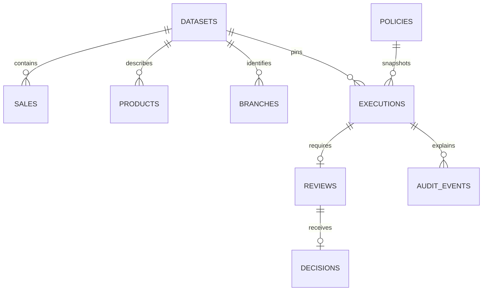

# Data model and report semantics

## Public synthetic source

`data/demo/` contains six independently named products, four demonstration branches and 240 branch/year/product records across 2016–2025. `scripts/generate_demo.py` creates it from fixed formulas. Original academic datasets and results derived from them are not distributed.

| Format | Active consecutive values | Interpretation |
| --- | --- | --- |
| M | 12 | Monthly periods |
| B | 6 | Bimonthly periods |
| S | 2 | Semester periods |
| C / E | 2 | Commercial seasons; E normalizes to C |

Active cells must be finite, non-negative values with at most two decimals. Inactive cells may be blank or zero. Unknown formats/products, duplicate keys, missing active values and non-zero inactive values fail ingestion. Alternate column placements are not guessed.

Annual aggregation totals periods for the labeled **reporting year**. Seasons may cross calendar years. No monthly allocation or reconstructed calendar-year attribution is performed.

Comparisons join common branch/product keys. Calendar-complete M/B/S rows may compare with one another; seasonal rows compare with seasonal rows. Seasonal/calendar changes are excluded. `observed_*` totals retain all reported rows; `base_total`/`current_total` use the compatible matched cohort. Coverage is matched keys divided by the union of both years' keys. Zero/missing matched baseline produces `variation=null` and `SIN_BASE`.

Policy v1 classifies unrounded Decimal variation: NORMAL > −10%; ADVERTENCIA > −20% and ≤ −10%; CRITICO ≤ −20%. Floats are used only for API/display conversion. Execution risk is the highest supported network/product/branch risk; a normal network average cannot conceal a critical segment.

## Persistence

Dataset identity hashes mode, source CSV and master bytes. Metadata records synthetic provenance, source hash, years, coverage and limitations. Imports create immutable snapshots. Sales retain normalized formats, period values and exact totals; products/branches are namespaced by dataset.

Executions record request/idempotency/thread/trace IDs, input, dataset, policy, independent technical/commercial/approval states, evidence, actual steps, duration and sanitized errors. Reviews persist the evidence requiring attention. A review receives at most one immutable decision with authenticated actor, timestamp, comment, policy and evidence. Audit events are append-only. LangGraph maintains versioned checkpoint tables in PostgreSQL.

Alembic revisions: 0001 initial schema; 0002 append-only histories; 0003 immutable evidence and deferred committed-decision enforcement. Destructive downgrades fail deliberately; use reviewed backup/restore procedures.
